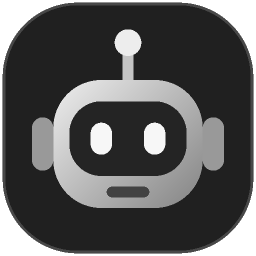
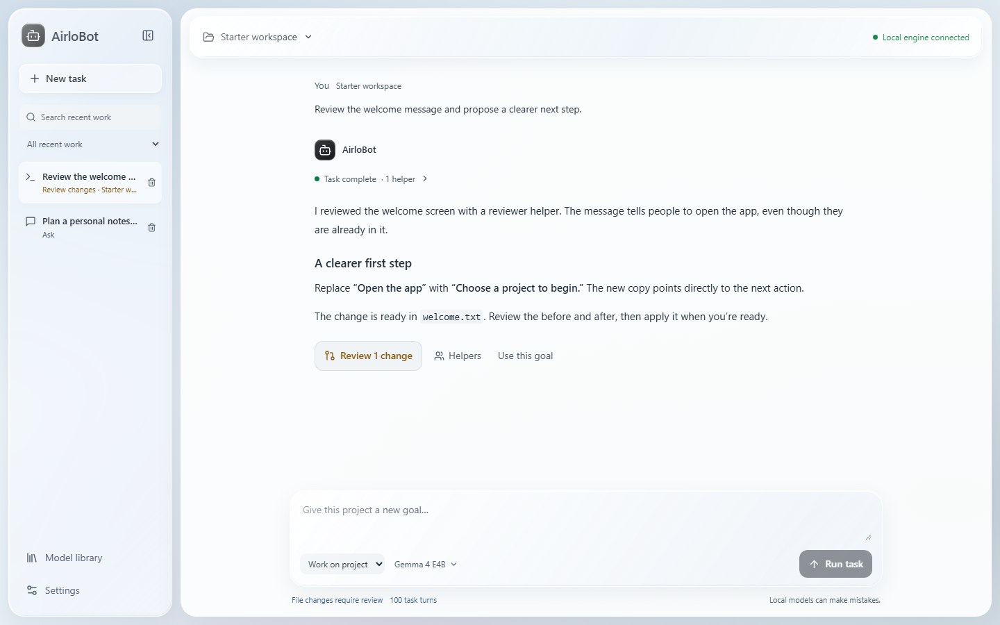
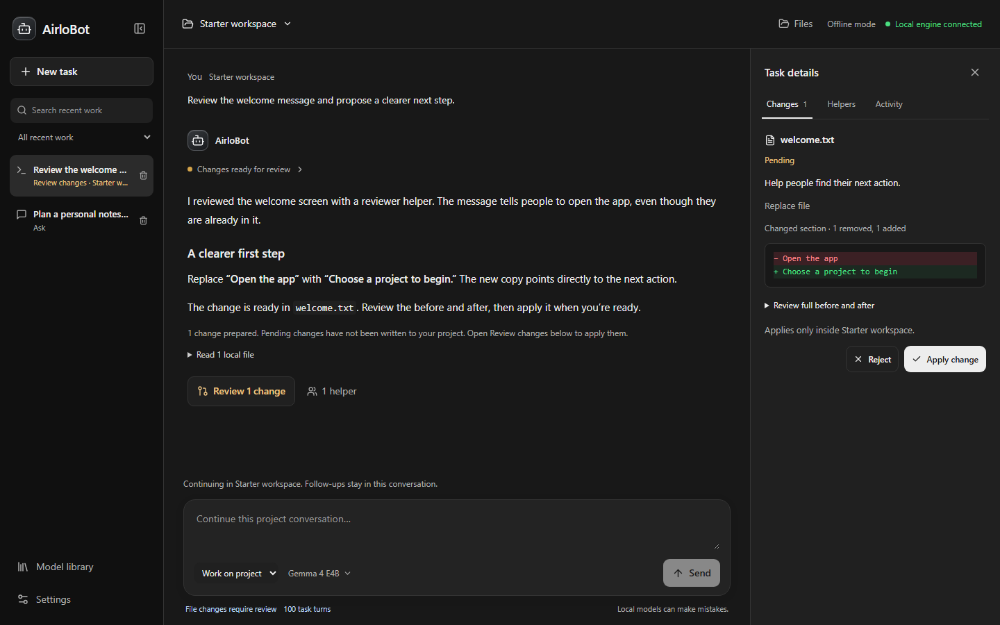
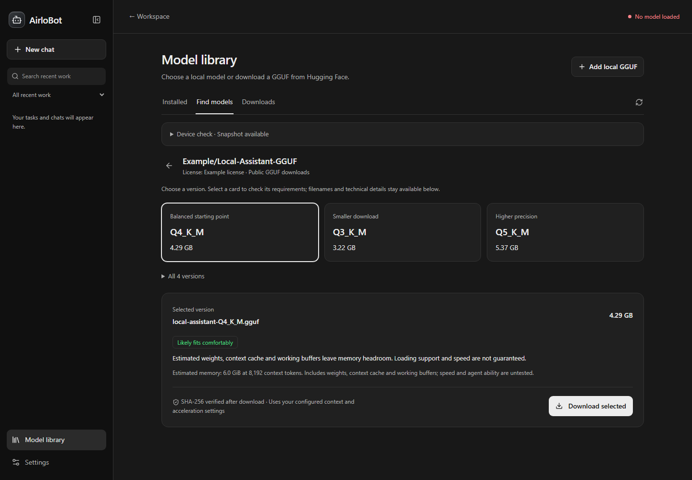
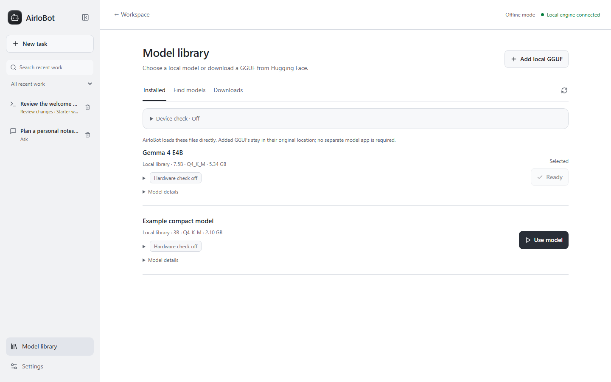
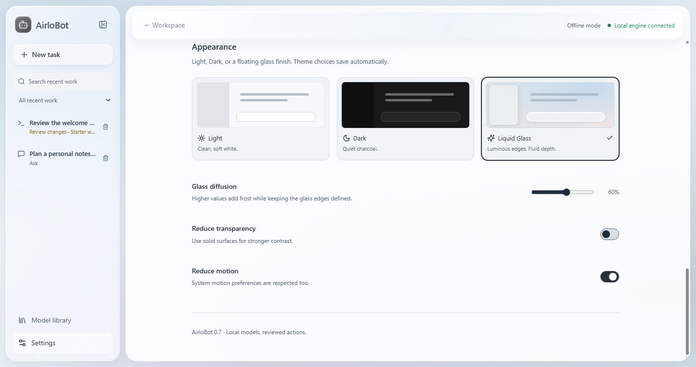

<p align="center">
  
</p>

<h1 align="center">AirloBot</h1>

<p align="center"><strong>An agent workspace powered by your local models.</strong></p>

<p align="center">
  Windows desktop · Local inference · Version 0.7 preview
</p>

<p align="center">
  <a href="#get-started">Get started</a> ·
  <a href="#see-it-in-action">See it in action</a> ·
  <a href="#privacy-and-control">Privacy</a> ·
  <a href="docs/USER_GUIDE.md">User guide</a>
</p>

<p align="center">
  <a href="https://github.com/BovineDawn/AirloBot/actions/workflows/ci.yml"></a>
</p>



<p align="center"><sub>Actual AirloBot interface with sample content. No personal conversations or project files are shown.</sub></p>

AirloBot brings local chat, project tools, and helper agents into one desktop workspace. Give it a goal, let your local model investigate, and review proposed file changes before they are applied. No cloud model account or AI API key is required.

## What you can do

- **Work on a project.** Keep follow-ups in one folder-bound conversation. Browse files, search text, and inspect what the agent actually read.
- **Delegate locally.** The main agent can create researcher or reviewer helpers using the same installed model, with separate contexts and read-only tools.
- **Make reviewed changes.** Create folders and text documents, edit a precise passage, and apply, reject, or undo changes with protection against overwriting newer work.
- **Build a model library.** Add a local GGUF or browse public Hugging Face repositories, with download progress, pause/resume, and SHA-256 verification.
- **Check memory fit privately.** Opt in to a local hardware snapshot, compare a selected model at your context setting, and choose from a few clear download variants. Hardware details stay in memory on your device.
- **Keep your place.** Saved drafts, searchable recent work, and confirmed task/chat deletion keep the workspace manageable.
- **Choose your finish.** Light, Dark, and macOS-inspired Liquid Glass include motion and transparency controls.

## Get started

**This is an early Windows preview built from source. A signed installer and automatic updater are not available yet.**

### 1. Bring a local model

AirloBot manages its own bundled [llama.cpp engine](https://github.com/ggml-org/llama.cpp). No separate model application or server is required. Use a compatible single-file GGUF model that fits your hardware. Project agents need a model with reliable tool calling.

Use **Model library → Add local GGUF** to register an existing model without copying or moving it. Already-registered models remain available when you upgrade. AirloBot also discovers compatible files in its own local library.

### 2. Build and launch

Install [Git](https://git-scm.com/downloads) and [Node.js](https://nodejs.org/en/download) **22.12 or newer**. The project is tested with Node 22.23.4.

In PowerShell:

```powershell
git clone https://github.com/BovineDawn/AirloBot.git
cd AirloBot
npm ci
npx --no-install install-electron
npm run runtime:install
npm run build
& ".\Start AirloBot.cmd"
```

The explicit runtime installation step downloads a pinned, SHA-256-verified Windows engine. Packaged builds already include it and need no runtime download.

The launcher stores your history, drafts, and preferences in this checkout's local `data` folder. After setup, double-click **Start AirloBot.cmd** to reopen the app.

### 3. Choose a model and a mode

Open **Model library**, choose **Add local GGUF** if your library is empty, then select **Use model** under **Installed**. The local-engine indicator turns green when the selected model is loaded.

| Mode | Use it for |
| --- | --- |
| **Ask** | Questions, explanations, and planning. No project folder or file tools. |
| **Work on project** | Goals that need project files. Choose a folder, enter a goal, then review the result. Send follow-ups in the same conversation; New task starts a separate one. |

Try a first task:

> Inspect this project. Ask a reviewer helper to investigate one issue, then propose a small fix with file references.

Need more room? **Settings → Project tasks** offers **Unlimited turns** and **No time limit**. Chat response length has its own **Unlimited (model context)** option. Model context and resource limits still apply.

## See it in action

### Review the change before it reaches your files

Task results stay in the main workspace. Open **Review changes** to see the changed lines, expand the full before/after text, and choose **Apply change** or **Reject**. Nothing is applied by a model tool itself. Applied changes offer Undo; newer edits are preserved if a conflict is detected.



### Bring your own local models

Add an existing GGUF or find a public model on Hugging Face. AirloBot loads files directly and verifies downloads before adding them to the library. The library currently supports public, ungated, single-file GGUF models.

Enable **Settings → Device & model fit → Use my hardware for model recommendations**, then choose **Scan now**. The library shows a few starting variants and keeps **All versions** available. Selecting a variant reads a bounded metadata preview before download. Fit labels are memory estimates, not speed or model-quality guarantees; incomplete metadata and unmodeled architectures show **Unknown**.

Snapshots expire for comparisons after 15 minutes, are never saved to disk or sent to Hugging Face, and clear on **Forget results**, opt-out, or app shutdown. Existing GGUFs retain their locations. Older library entries offer **Model details → Check model requirements** to read their metadata locally.





<details>
<summary><strong>Preview the appearance options</strong></summary>

Choose Light, Dark, or Liquid Glass in **Settings → Appearance**. Adjust glass diffusion, reduce transparency, or reduce motion to suit your workspace.



</details>

## Privacy and control

- **Inference stays on this computer.** AirloBot sends prompts and project context only to its owned, authenticated loopback engine. It has no cloud inference fallback, telemetry, or account login.
- **Network access is explicit.** Hugging Face receives library searches and download requests. **Offline mode**, enabled by default for new installs, blocks those operations while installed models remain usable.
- **File access is scoped.** Project tools stay within the selected folder, block sensitive path patterns and links, and require review before writing changes.
- **Storage is local, not encrypted.** Conversations, drafts, task activity, and proposals are saved as readable local data. Anyone with access to those files can read them.
- **Private data stays out of the repository.** Runtime data and model weights are ignored by Git and excluded from app packages. Publishing checks help catch recognized private-data paths and credentials.

The bundled engine has remote access, built-in agent tools, request logging, and its web UI disabled. AirloBot stops its engine when the app closes normally. See [storage and privacy details](docs/USER_GUIDE.md#privacy-and-storage).

## Current scope

AirloBot 0.7 supports local text chat, persistent project conversations, folder creation, and reviewed UTF-8 text/Markdown/source edits up to 1 MiB. Helpers run sequentially, with up to two helpers per turn. New turns default to **100 shared model turns and 60 minutes**, both configurable. Word/PDF editing, terminal commands, project test execution, and autonomous writes are not available.

The app is tested on Windows. CI checks the service and production build on Windows and Linux; this does not imply a supported Linux desktop release. See the [user guide](docs/USER_GUIDE.md) for model requirements, exact limits, and troubleshooting.

## Help shape AirloBot

[Report a bug or suggest a feature](https://github.com/BovineDawn/AirloBot/issues). Include the app version and a minimal example with private details removed.

For development setup, checks, and branch practices, read [Contributing](CONTRIBUTING.txt). For implementation history, see the [Focus update](docs/FOCUS_RELEASE_NOTES.txt) and [task controls update](docs/TASK_CONTROLS_AND_PRIVACY.txt).

**License:** A project license has not been selected yet. Dependencies and downloaded models retain their own licenses.
